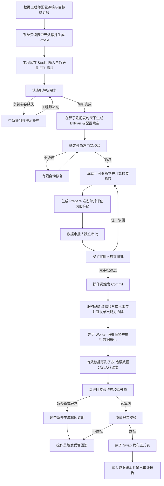
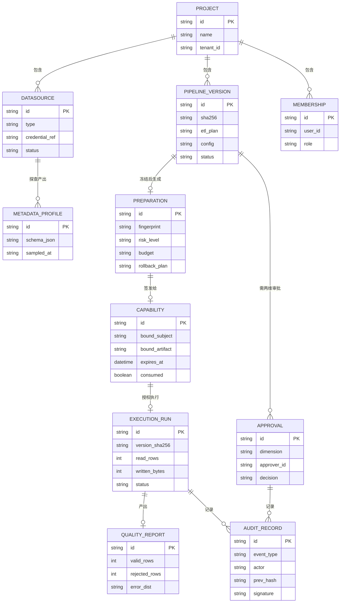

# 生产级 ETL-Agent 数据集成平台 需求规格说明书（PRD）

> | 文档名称 | 需求规格说明书（PRD） |
> |----------|----------------------|
> | 版本 | v1.0（基线） |
> | 作者角色 | 产品经理 |
> | 日期 | 2026-10-13 |
> | 状态 | 基线 |

> **v0.2 修订说明**：按 PRD 编写规范重构为固定 11 章结构；将技术选型（LangGraph / Celery / SeaTunnel / Ed25519 等）由功能需求移入「10. 依赖与约束」，功能需求只描述能力目标。参照系统逆向分析移至附录 A。
>
> **v0.3 修订说明**：闭环原待确认问题——性能口径写死（不含澄清等待 / 明确数据规模）、删除不可验证的 SLA、定义数据敏感四级分级（附录 C）、确认自建认证与交付时间窗、收敛算子初始范围与质量规则来源、安全策略改为人工确认生效。
>
> **v1.0 修订说明（本版定稿为基线）**：交付周期确定为 **15 天（2026-10-13 ~ 2026-10-27）**，补充三段交付节奏与演示环境约束；原 Q1–Q11 全部闭环，决策痕迹见第 11 章。**本版无遗留未决问题。**
>
> **v1.0 补充（参考实现对标）**：新增**附录 D**——对照本地课程项目「尚硅谷 AI 电商运营助手」的受控 Agent 平台实现，记录可借鉴机制、**必须自建的 5 项能力缺口**、可迁移的验收方法与工程踩坑。据此在第 5 章、第 9 章补充可靠性/治理条目。**需求基线未变。**

---

## 1. 产品目标与价值

- **背景与要解决的问题**：企业异构数据集成长期依赖人工编写 ETL 作业，存在三个痛点——① 需求到可执行作业的转换依赖资深工程师经验，新人上手周期长；② 作业从创建到投产缺少强制性的职责分离与安全门禁，误操作与越权风险高；③ 执行失败后缺少可解释的根因与受管回滚手段，故障恢复靠人肉排查。
- **建设目标**：建设一个「自然语言驱动 + 安全内核治理」的生产级 ETL 控制面平台。用户用自然语言描述集成需求，系统生成结构化的作业方案与可执行配置；方案在投产前必须经过确定性门禁、不可变版本冻结、双维度独立审批与单次授权；执行过程受预算监督，数据经质量分流后原子发布；全过程生成不可篡改的审计证据。
- **成功标准（可量化）**：
  - 指标 1：自然语言生成作业方案的**算子（组件）选择准确率 ≥ 90%**（参照系统 IBM DataStage Assistant 在 llama-3.3-70b 下达 96.4%，取其下沿作为本项目验收线）。
  - 指标 2：**主流程 100% 通过三阶段协议**——所有投产执行（Commit）均可追溯到一次合法 Prepare 与两个独立审批人，无任何旁路执行路径。
  - 指标 3：**一名未接触过本系统的工程师**，仅凭文档，在 ≤30 分钟内独立完成示例场景（MySQL → Doris 增量同步）的端到端流程，全程无研发人员介入。
  - 指标 4：Benchmark 评测集上 **P0 高危操作拦截率 = 100%**（不允许任何高危操作绕过门禁）。

## 2. 用户角色与权限矩阵

| 角色 | 职责描述 | 核心权限 |
|------|---------|---------|
| 数据工程师（Maker） | 登记数据源连接、发起元数据探查、输入自然语言需求、调试并生成 Pipeline 候选方案、提交不可变版本与审批申请 | 创建/编辑本人 Pipeline 与连接、发起探查、提交版本与审批、查看本项目只读元数据；**不可审批任何自己提交的版本** |
| 数据审批人（Checker 1） | 审查需求描述、Schema 字段映射、脱敏前后结构对比、质量规则与 DAG 结构，执行**数据维度**审批 | 审批/驳回数据维度、查看脱敏前后结构对比、查看完整字段映射；**不可执行 Commit** |
| 安全审批人（Checker 2） | 审查资源范围、数据敏感分级、执行预算、凭据引用与回滚方案，执行**安全维度**审批；管理 Benchmark 与安全策略 | 审批/驳回安全维度、管理 Benchmark 测试集与安全策略、查看风险评级；**不可执行 Commit** |
| 系统操作员 | 在全部审批通过后执行 Commit、触发受管执行、监控运行状态、执行任务暂停/取消/回滚与凭据轮转 | 执行 Commit、启停/取消任务、发起受管回滚、凭据轮转；**不可修改 Pipeline 内容、不可审批** |
| 审计人员 | 查看执行历史、审计事件、签名证据账本、数据质量报告与 Benchmark 评测大盘 | 全局只读（含证据账本与审计报告）；**无任何写权限** |

- **强制职责分离规则**：申请人禁止自批；同一人禁止同时占用同一版本的数据审批人与安全审批人两个职责槽；操作员与审批人角色在**同一高风险操作**上互斥。

## 3. 用户故事

- US-01：作为**数据工程师**，我希望用表单登记异构数据库与文件/API 数据源连接并做连通性测试，以便在生成作业前确认源端与目标端可达。
- US-02：作为**数据工程师**，我希望对数据源发起只读元数据探查并看到字段类型与脱敏样本，以便在不接触明文数据的前提下理解数据结构。
- US-03：作为**数据工程师**，我希望用自然语言描述集成需求（而不是手写配置），以便降低编写作业的门槛。
- US-04：作为**数据工程师**，当我的需求描述缺少关键参数时，我希望系统主动中断并逐项提问、我补充后能继续而不是重头再来，以便补齐信息时不丢失已有进度。
- US-05：作为**数据工程师**，我希望看到生成结果包含结构化方案、可执行配置、DAG 拓扑与字段映射差异，以便在提交前审查系统到底打算做什么。
- US-06：作为**数据工程师**，我希望系统只从已注册的算子能力范围内生成方案，并且在无法匹配时明确告诉我"不支持"而不是编造一个组件，以便我不被看似合理实则错误的方案误导。
- US-07：作为**数据审批人**，我希望看到冻结不可变的方案快照与脱敏前后的结构对比，以便我的审批结论对应一个确定的版本而不是会漂移的内容。
- US-08：作为**安全审批人**，我希望在审批前看到资源影响范围、数据敏感分级、执行预算与回滚方案，以便判断这次执行的风险是否可接受。
- US-09：作为**系统操作员**，我希望只有当我确认所有审批槽位均已合法完成后才能 Commit，以便我不会在不知情的情况下越权放行。
- US-10：作为**系统操作员**，我希望执行过程实时显示吞吐、写入量与错误分流明细，并在超预算时自动硬中断，以便及时止损。
- US-11：作为**系统操作员**，当执行失败时，我希望看到可解释的根因说明并能一键受管回滚，以便快速恢复原状态而不用手工清理残留。
- US-12：作为**审计人员**，我希望任何一次投产执行都能追溯到完整的审批链与不可篡改的证据记录，以便事后核查时结论可信。

## 4. 功能需求清单（需求池）

| 编号 | 模块 | 功能 | 优先级 | 说明 |
|------|------|------|--------|------|
| FR-01 | A 数据源接入 | 异构数据库连接登记（MySQL/PostgreSQL/Oracle/Doris/ClickHouse） | P0 | 对应 US-01 |
| FR-02 | A 数据源接入 | 文件与 API 数据源接入（CSV/Excel/JSON/Parquet/S3-MinIO/REST API） | P0 | 对应 US-01 |
| FR-03 | A 数据源接入 | 敏感凭据受管加密存储与引用（不落明文） | P0 | 对应 US-01、US-08 |
| FR-04 | A 数据源接入 | 安全连通性测试 | P0 | 对应 US-01 |
| FR-05 | A 元数据探查 | 只读元数据探查（Schema、字段类型、近似统计、敏感分级自动打标） | P0 | 对应 US-02；分级规则见附录 C |
| FR-06 | A 元数据探查 | 脱敏样本采样（不返回明文原始值） | P0 | 对应 US-02 |
| FR-07 | A 元数据探查 | 元数据 Profile 版本化留档 | P1 | 供审批环节对照 |
| FR-08 | B 需求生成 | 自然语言需求输入与源端/目标端选择 | P0 | 对应 US-03 |
| FR-09 | B 需求生成 | 澄清中断：关键参数缺失时中断提问并保持上下文 | P0 | 对应 US-04 |
| FR-10 | B 需求生成 | 状态恢复：补充信息后从断点继续，不重跑已完成阶段 | P0 | 对应 US-04 |
| FR-11 | B 需求生成 | 算子能力注册表：以受管清单约束方案的生成空间 | P0 | 对应 US-06；P0 范围约 10 个算子，见附录 B |
| FR-12 | B 需求生成 | 结构化作业方案（EtlPlan）生成 | P0 | 对应 US-05 |
| FR-13 | B 需求生成 | 可执行配置候选生成 | P0 | 对应 US-05 |
| FR-14 | B 需求生成 | 无法匹配算子时返回"不支持"并请求澄清，禁止臆造组件 | P0 | 对应 US-06 |
| FR-15 | B 需求生成 | 表达式/转换脚本辅助生成 | P1 | 参照系统能力之一 |
| FR-16 | B 需求生成 | 多模型 Provider 适配与切换 | P1 | 用于准确率对比评测 |
| FR-17 | B 需求生成 | 校验不通过时的有限自动修复（有次数上限） | P1 | 对应 US-05 |
| FR-18 | C 门禁与版本 | 确定性静态门禁校验（语法 + Schema 对齐） | P0 | 对应 US-05 |
| FR-19 | C 门禁与版本 | 不可变版本冻结与摘要指纹计算 | P0 | 对应 US-07 |
| FR-20 | C 门禁与版本 | 版本间 Diff 对比（Schema/配置/质量规则） | P1 | 对应 US-07 |
| FR-21 | D 审批授权 | 风险评级与审批职责槽分配 | P0 | 对应 US-08、US-09 |
| FR-22 | D 审批授权 | Prepare 准备单生成（含影响范围/预算/回滚方案，零外部副作用） | P0 | 对应 US-08 |
| FR-23 | D 审批授权 | 四眼独立审批（数据维度 + 安全维度） | P0 | 对应 US-07、US-08 |
| FR-24 | D 审批授权 | 职责分离强制：拦截自批与职责混用 | P0 | 对应 US-09 |
| FR-25 | D 审批授权 | Commit 三阶段协议收口与指纹/审批事实复核 | P0 | 对应 US-09 |
| FR-26 | D 审批授权 | 单次执行能力令牌签发与校验（绑定工具/主体/环境/制品） | P0 | 对应 US-09 |
| FR-27 | D 审批授权 | 防重放：令牌仅可消费一次 | P0 | 对应 US-09 |
| FR-28 | D 审批授权 | 任务投递与业务事实的原子落库 | P1 | 防止"落库成功但任务丢失" |
| FR-29 | E 执行调度 | 异步任务调度与执行 | P0 | 对应 US-10 |
| FR-30 | E 执行调度 | 数据面引擎对接（受管命令 → 作业执行 → 状态回传） | P0 | 对应 US-10 |
| FR-31 | E 执行调度 | 调度策略配置（周期/触发） | P1 | — |
| FR-32 | F 质量与发布 | 质量契约声明：字段级规则与错误码标签 | P0 | 对应 US-10；规则由工程师显式声明，不由模型生成 |
| FR-33 | F 质量与发布 | 错误数据分流写入错误表并记录原始值与违规原因 | P0 | 对应 US-10 |
| FR-34 | F 质量与发布 | 影子表写入 + 校验通过后原子 Swap 发布正式表 | P0 | 对应 US-10 |
| FR-35 | F 质量与发布 | 运行时监督契约：行数/字节/时长/放大比/拒绝率预算监控 | P0 | 对应 US-10 |
| FR-36 | F 质量与发布 | 超预算硬中断并保存失败快照 | P0 | 对应 US-10、US-11 |
| FR-37 | F 质量与发布 | 可解释根因诊断与修复建议 | P1 | 对应 US-11 |
| FR-38 | F 质量与发布 | 受管回滚（清理未发布残留并释放资源） | P1 | 对应 US-11 |
| FR-39 | G 审计评测 | 不可篡改证据账本（哈希链 + 签名检查点） | P0 | 对应 US-12 |
| FR-40 | G 审计评测 | 运行报告与审计输出（准备单/执行记录/质量报告/账本记录） | P0 | 对应 US-12 |
| FR-41 | G 审计评测 | 分层仿真评测（L0 静态注入 / L1 模拟故障 / L2 真实链路） | P1 | 对应成功标准 1、4 |
| FR-42 | G 审计评测 | 版本化 Benchmark 自动化测试集与准确率大盘 | P1 | 对应成功标准 1 |
| FR-43 | G 审计评测 | 安全策略版本管理与人工确认生效 | P2 | 策略变更一律人工确认后生效，不做自动进化 |
| FR-44 | H 平台基础 | 用户认证与多租户项目隔离 | P0 | 全部 US 的前提 |
| FR-45 | H 平台基础 | 项目成员与角色管理 | P0 | 对应 US-09 |
| FR-46 | H 平台基础 | 总览工作台（连接数/版本数/待审批/成功率） | P1 | — |

- 优先级：P0 必须 / P1 重要 / P2 可选
- P0 共 31 条，**100% 覆盖主流程**（连接 → 探查 → 生成 → 门禁 → 审批 → 授权 → 执行 → 质量 → 发布 → 审计）

## 5. 非功能需求（量化）

| 类别 | 要求 | 指标 |
|------|------|------|
| 性能 | 控制面常规接口响应 | P95 < 500ms【本项目实测校准】 |
| 性能 | 系统纯处理耗时（**不含澄清等待**）：需求提交 → 方案候选产出 | P95 < 60s【本项目实测校准】 |
| 性能 | 元数据探查（**500 张表 / 约 1 万字段**规模） | < 30s【本项目实测校准】 |
| 安全 | 凭据存储 | 全部加密存储，任何接口与日志不返回明文 |
| 安全 | 元数据返回 | 全链路无敏感明文泄露，样本一律脱敏 |
| 安全 | 授权令牌有效期 | ≤ 5 分钟且仅可消费一次 |
| 安全 | 高危操作拦截 | P0/P1 高危操作拦截率 100%（不允许旁路） |
| 安全 | 职责分离 | 自批拦截率 100%，职责混用拦截率 100% |
| 合规 / 审计 | 审计覆盖 | 关键事件（Prepare / Approve / Commit / 执行 / 回滚）证据账本覆盖率 100% |
| 合规 / 审计 | 证据不可篡改 | 哈希链校验 100% 通过，篡改可被检出 |
| 可用性 | 状态可恢复 | 控制面重启后，未完成流程可从检查点恢复，已完成的阶段不重跑 |
| 并发 | 并发用户 | 10 并发用户【本项目压测实测】 |
| 并发 | 并发执行任务 | 单项目 3 个并发执行【本项目压测实测】 |
| 可靠性 | 任务重复投递 | 副作用**仅执行一次**（幂等台账唯一约束兜底），重复投递返回历史结果 |
| 可靠性 | Worker 心跳失败 | **不伪造成功**，由租约过期回收并由维护任务重排 |
| 治理 | 审批超时 | 到期**自动失效并级联终止**关联执行，不得停留在待审状态 |
| 兼容性 | 浏览器 | Chrome / Edge 最新两个大版本 |

> 说明：标注【本项目实测校准】的数值为**设计目标**，验收前须由项目组压测/度量后回填实测值；不带标注的为规范性硬约束，直接构成验收条件。可用性不设 SLA（课程环境下无法长期观测验证），改以"重启后断点恢复"这一可演示行为衡量。

## 6. 核心业务流程图



## 7. 关键页面原型说明

**页面 1：总览工作台**
```
+------------------------------------------------------+
| ETL-Agent | 项目: 订单域        [数据工程师 ▾]        |
+------------------------------------------------------+
| [连接数 12] [Pipeline 8] [待审批 3] [运行成功率 96%] |
+------------------------------------------------------+
| 待我处理                                    [快捷入口]|
|  - PV-0007 待数据审批      (2 小时前)                 |
|  - PV-0009 待安全审批      (5 小时前)                 |
+------------------------------------------------------+
| 最近运行                                              |
|  RUN-1023 成功 1.2M 行  ▓▓▓▓▓▓▓▓▓▓  02:14            |
|  RUN-1022 中断 拒绝率22% ▓▓░░░░░░░░  00:41  [诊断]   |
+------------------------------------------------------+
```

**页面 2：Pipeline Studio（设计与生成工作台）**
```
+---------------------------+--------------------------+
| 需求输入与澄清            | 方案配置与拓扑审查       |
| 源端[MySQL▾] 目标[Doris▾] | [EtlPlan] [配置] [DAG]   |
| +-----------------------+ | +----------------------+ |
| | 把订单表和用户表汇总  | | |  o source            | |
| | 成宽表,按天增量      | | |  |-> o join           | |
| +-----------------------+ | |  |-> o filter        | |
| 状态机: 澄清中 ⏸          | |  |-> o sink          | |
|  ? 主键去重规则未指定     | | +----------------------+ |
|  > [填写] [跳过]          | | 字段映射 Diff:           |
|                           | |  + order_id  (新增)      |
+---------------------------+ |  - user_name (类型变更)  |
| 门禁校验: ✅语法 ✅Schema | +--------------------------+
| [冻结版本] [提交审批]     | 脱敏对比: ✅无明文暴露    |
+---------------------------+--------------------------+
```

**页面 3：运行中心与审批控制台**
```
+------------------------------------------------------+
| Preparation 准备单  PV-0009                          |
+------------------------------------------------------+
| 影响范围: doris.ods_order_wide (影子表)              |
| 数据分级: L2 内部 / 含 L3 敏感字段 2 个（已脱敏）     |
| 预算: ≤500万行 / ≤2GB / ≤30min                       |
| 回滚方案: 丢弃影子表, 正式表不变                     |
+------------------------------------------------------+
| 审批槽位                                             |
|  数据审批人 [张三 ✓ 通过]  安全审批人 [李四 ⏳ 待审]  |
|  [通过] [驳回] [查看 Diff]    申请人: 王五 (不可自批) |
+------------------------------------------------------+
| 执行监控  RUN-1023                                   |
| 吞吐 ▁▃▅▇█▇▅  读取 82万行  写入 1.2GB  拒绝率 0.3%  |
| 错误分流: E001 类型解析 128 条 [查看样本]            |
|                           [暂停] [取消] [回滚]       |
+------------------------------------------------------+
```

**页面 4：安全治理与 Benchmark 页**
```
+------------------------------------------------------+
| Benchmark 评测                                       |
| 数据集 v3 (128 用例)   [触发评测]                     |
+------------------------------------------------------+
| 算子选择准确率   92.3%  ▓▓▓▓▓▓▓▓▓░  目标 ≥90%  ✅    |
| 属性生成准确率   85.1%  ▓▓▓▓▓▓▓▓░░  目标 ≥85%  ✅    |
| P0 高危拦截率   100.0%  ▓▓▓▓▓▓▓▓▓▓  目标 =100% ✅    |
+------------------------------------------------------+
| 历史趋势 [v1] [v2] [v3]                              |
+------------------------------------------------------+
| 安全策略管理（变更需人工确认生效）       [策略管理]    |
|  - rbac.separation-of-duties      v4  启用           |
|  - capability.single-use          v2  启用           |
+------------------------------------------------------+
```

## 8. 数据实体初稿（ER）



## 9. 验收标准（AC）

| 功能（FR） | 验收条件（前置—操作—预期） |
|-----------|--------------------------|
| FR-01/02 | 给定已登录的数据工程师，当登记一个 MySQL 连接与一个 CSV 文件源时，则两者均出现在连接列表且状态为已配置 |
| FR-03 | 给定任一连接已保存，当查询接口与日志时，则任何位置均不出现明文凭据，只出现凭据引用标识 |
| FR-04 | 给定一个参数错误的连接，当执行连通性测试时，则返回明确失败原因且不泄露凭据内容 |
| FR-05/06 | 给定一个生产库连接，当发起元数据探查时，则返回 Schema 与字段类型，样本列全部脱敏、无明文值 |
| FR-05（分级） | 给定含手机号与身份证号的表，当探查完成时，则对应字段被自动标注为 L3 敏感与 L4 机密（规则见附录 C） |
| FR-08 | 给定 Studio 页面，当输入一段自然语言需求并选择源端/目标端时，则提交成功并进入解析状态 |
| FR-09/10 | 给定一条缺少主键去重规则的需求，当解析时，则流程中断并提问；当补充该规则后，则从中断点继续且已完成阶段不重跑 |
| FR-11/14 | 给定一个无法由已注册算子实现的需求，当生成时，则返回"当前算子不支持"并请求澄清，**不生成任何未注册组件** |
| FR-12/13 | 给定一条合法需求，当生成完成时，则产出结构化方案、可执行配置、DAG 拓扑与字段映射结果 |
| FR-18 | 给定一份语法正确但 Schema 不匹配的配置，当执行门禁时，则校验不通过并指出不匹配的字段 |
| FR-19 | 给定一份门禁通过的方案，当冻结版本时，则生成含 SHA256 摘要的不可变版本，后续任何修改产生新版本号 |
| FR-21/22 | 给定一个冻结版本，当调用 Prepare 时，则返回含影响范围、数据分级、执行预算、回滚方案与审批人槽位的准备单，且**未产生任何外部副作用** |
| FR-23/24 | 给定申请人王五，当王五尝试审批自己提交的版本时，则被拒绝；当同一用户同时占用两个审批槽位时，则被拒绝 |
| FR-25 | 给定仅完成一个维度审批的版本，当操作员尝试 Commit 时，则被拒绝并提示缺失的审批维度 |
| FR-26/27 | 给定已双审通过的版本，当 Commit 成功时，则签发一个有效期 ≤5 分钟的能力令牌；当重复使用同一令牌时，则第二次被防重放拒绝 |
| FR-27（幂等） | 给定同一执行任务被重复投递，当 Worker 处理两次时，则数据搬运**只发生一次**，第二次直接返回首次结果 |
| FR-22/23（策略边界） | 给定一个 P0/P1 级高危操作，当未经安全维度审批就尝试执行时，则被运行时硬拦截，**策略许可不等于可跳过审批** |
| FR-29/30 | 给定已签发的合法令牌，当 Worker 消费任务时，则调用数据面引擎执行并回传运行状态与指标 |
| FR-32/33 | 给定声明了类型校验规则的作业，当源数据含格式异常行时，则异常行被写入错误表并记录原始值与错误码 |
| FR-34 | 给定质量报告达标，当执行原子 Swap 时，则正式表数据被无缝替换，期间查询不中断 |
| FR-35/36 | 给定预算为拒绝率 ≤20%，当实际拒绝率达到 22% 时，则监督引擎触发硬中断并终止作业、保存失败快照 |
| FR-37 | 给定一次硬中断，当查看诊断时，则输出可解释根因（如字段类型解析异常）与修复建议 |
| FR-38 | 给定一次中断的执行，当操作员触发回滚时，则未发布的影子表残留被清理、资源被释放、正式表保持不变 |
| FR-39/40 | 给定完成的一次投产执行，当审计人员查看时，则可见完整审批链、准备单、执行记录、质量报告与哈希链校验通过的证据账本 |
| FR-41/42 | 给定版本化 Benchmark 集，当触发评测时，则输出算子准确率、属性准确率与高危拦截率报告 |
| FR-44/45 | 给定两个项目，当 A 项目用户访问 B 项目资源时，则被拒绝；角色变更立即生效 |

## 10. 依赖与约束

- **外部依赖**：
  - 大模型推理服务（用于需求解析与方案生成）——**不完全可控**，需支持多 Provider 切换以规避单一供应商风险（FR-16）
  - 上游数据源系统（MySQL / PostgreSQL / Oracle / Doris / ClickHouse / 对象存储 / REST API）——**不可控**，仅只读探查
  - 企业统一身份认证——**本项目不对接**，改由平台自建账号体系（代码内收敛单一认证接口，预留 OIDC 适配点）

- **技术栈约束（由课程验收要求规定，非自由设计选择）**：
  - 控制面：Vue 前端 + FastAPI 控制面服务
  - 编排：LangGraph 状态机（含 Checkpoint 中断恢复）
  - 异步：Celery Worker / Beat
  - 存储：PostgreSQL + Redis
  - 数据面：Apache SeaTunnel（Zeta 引擎），控制面**不直连搬运海量业务数据**
  - 安全内核：PDP 风险决策（P0–P3）、`prepare → approve → commit` 三阶段协议、Ed25519 签名单次能力令牌、防重放 Guard、事务 Outbox、哈希链证据账本
  - 凭据：SecretProvider / Vault KV v2

- **架构约束**：
  - 控制面与数据面严格分离，所有副作用执行必须经唯一出口（Tool Broker）
  - 存在旁路执行路径 = 不可接受（对应成功标准 2）

- **参考实现（非约束，供设计阶段取用）**：本地课程项目「尚硅谷 AI 电商运营助手」已实现同构的受控 Agent 平台（策略决策 / 工具网关 / 租约 fencing / 事务性 Outbox / 一次性审批），机制对照、能力缺口与验收方法见**附录 D**。

- **时间窗约束**：课程交付周期 **2026-10-13 至 2026-10-27，共 15 天**。

- **交付节奏（建议）**：
  - **D1–D5**：打通「连接 → 元数据探查 → 需求生成 → 门禁校验」，产出可生成并通过门禁的方案
  - **D6–D10**：打通「双维审批 → Commit 授权 → 受管执行 → 质量发布」，产出可投产的完整链路
  - **D11–D15**：收口「审计报告 → Benchmark 评测 → 端到端联调 → 演示准备」

- **交付环境约束**：演示与验收采用**本地 Docker Compose 单机部署**；演示数据由造数脚本生成（示例场景 MySQL → Doris）。不引入 Kubernetes 等编排依赖（实施中可调整）。

## 11. 待确认问题（Open Questions）

**本版（基线）无遗留未决问题。** 全部事项已闭环，决策痕迹记录如下，供后续复核。

| 编号 | 原问题 | 处置结论 | 落地位置 |
|------|--------|---------|---------|
| Q1 | 人工编写作业的时间基线如何测量 | 改为**绝对值指标**：新手仅凭文档 ≤30 分钟独立完成端到端，不依赖不可测的基线 | 第 1 章 指标 3 |
| Q2 | 生成/探查耗时的目标值缺依据 | 口径写死（不含澄清等待；500 表 / 1 万字段），数值由项目组实测回填 | 第 5 章 |
| Q3 | SLA 与并发数为建议值 | **删除 SLA**（课程内不可验证）；可用性改为可演示的"重启后断点恢复"；并发定为 10 用户 / 3 执行 | 第 5 章 |
| Q4 | 数据敏感分级标准未定义 | 采**平台自定义四级**（L1 公开 / L2 内部 / L3 敏感 / L4 机密），规则可机检、自动打标 | 附录 C |
| Q5 | 是否对接企业统一身份认证 | **不对接**，平台自建账号体系，预留 OIDC 适配点 | 第 10 章 |
| Q6 | 项目时间窗未给出 | 交付周期 **2026-10-13 ~ 2026-10-27，共 15 天** | 第 10 章 |
| Q7 | 算子注册表初始覆盖范围 | P0 仅覆盖示例场景所需**约 10 个算子**，不追求 120+ 全量 | FR-11 / 附录 B |
| Q8 | 质量规则由谁编写 | P0 **由工程师显式声明**，不由模型生成（安全相关决策） | FR-32 |
| Q9 | 安全进化闭环的自动化边界 | **一律人工确认后生效**，不做自动策略进化 | FR-43 |
| Q10 | 15 天窗口的分阶段交付节奏 | 按 **D1–5 / D6–10 / D11–15** 三段推进 | 第 10 章 |
| Q11 | 验收方式与演示环境 | 本地 **Docker Compose 单机部署**，演示数据由造数脚本生成 | 第 10 章 |

---

## 附录 A：参照系统对标分析（IBM DataStage Assistant）

> 本附录为**竞品逆向解读**，非 PRD 正式章节，仅作设计参照。资料来源：IBM watsonx.data integration 官方文档、AAAI/IAAI 论文。**未使用本地逆向工具**（目标为云端 SaaS，无本地制品，见限制说明）。

### A.1 系统定位
IBM DataStage Assistant 是嵌入 DataStage Flow Designer 的生成式 AI 助手，包含三个组件：**Intent-Based ETL Flow Generator**（自然语言 → 作业流）、**Transformer Expression Generator**（自然语言 → 转换表达式）、**Document Explorer**（基于产品文档的 RAG 问答）。

### A.2 可借鉴的四个设计决策

| 决策 | DataStage 做法 | 本项目对应 |
|------|---------------|-----------|
| **限制生成空间防幻觉** | 两步预测：先选 operator，再从该 operator 的已知属性集生成全部属性；模型只能输出已知算子，无法编造 | FR-11 算子能力注册表 + FR-14 不支持即澄清 |
| **显式承认不知道** | 预留 `unknown` 算子；无匹配时不硬猜，而是向用户追问细节 | FR-09 澄清中断 |
| **离线构建上下文库** | 从产品文档离线抽取算子与属性（描述/是否必填/默认值/类型）构建上下文数据库 | FR-11 的注册表构建方式 |
| **零数据外泄** | 仅处理用户输入的文本；客户数据与元数据不出 DataStage；不直连数据源；所有流程变更需用户显式确认 | FR-06 脱敏样本 + FR-03 凭据受管 + FR-23 人工审批 |

### A.3 公开性能数据（作为本项目目标值参照）

| 指标 | llama-3.3-70b | granite-3.1-8b |
|------|--------------|----------------|
| 算子预测准确率（整体） | 96.4% | 88.0% |
| — 单算子场景 | 98.1% | — |
| — 多算子场景 | 92.6% | — |
| 属性生成准确率 | 87.0% | 77.7% |
| 表达式生成准确率 | 87.0% | 81.8% |

- 用户研究：新手耗时最多下降 **90%**，专家最多下降 **50%**。
- 默认模型：`granite-3.1-8b-instruct`；部署形态为容器化 FastAPI on RHEL / Kubernetes，Milvus 向量库，项目级 opt-in 启用。

> **本项目取值说明**：成功标准 1 采用 90%（低于对标系统的 96.4%），因为本项目还要额外处理多算子组合与目标库方言差异，留出容差。

### A.4 限制说明
- 目标系统为云端 SaaS，本地无安装包、无 ASAR/二进制制品，且受限网络下无法建立 CDP 端点，**本地逆向工具链不适用**；上述结论全部来自公开文档与论文，属于**二手证据**，未经本地制品校验。若后续需一手证据，须获取可安装制品或可访问的调试端点。

## 附录 B：算子能力注册表初始范围（FR-11 输入）

本地 Apache SeaTunnel 2.3.13 发行包的 `connectors/plugin-mapping.properties` 提供了一份**可用的初始算子清单**，共 120+ 条 `source` / `sink` 映射（如 `seatunnel.source.MySQL-CDC = connector-cdc-mysql`、`seatunnel.sink.Doris = connector-doris`）。

建议初始范围（Q7 结论，已定稿）：
- **P0 覆盖**：示例场景所需子集——MySQL 系列、PostgreSQL 系列、Doris、ClickHouse、文件类（CSV/JSON/Parquet/S3File）、HTTP。
- **P1 覆盖**：其余连接器按需分批纳入注册表。
- **注册表字段**：算子标识、类型（source/sink/transform）、实现制品、属性清单（名称/是否必填/默认值/类型）、方言约束。

> 注：注册表结构与 SeaTunnel 的具体映射属于**实现细节**，PRD 层面只要求"存在受管算子清单且生成空间受其约束"；120+ 连接器的完整清册应在设计阶段产出，不在此展开。

---

## 附录 C：数据敏感分级定义（Q4 结论）

平台采用**自定义四级敏感度**，不采用国家"一般 / 重要 / 核心数据"三级框架——后者面向重要数据出境与监管报送，超出本项目范围。分级在元数据探查阶段**自动打标**，作为安全审批人的判断依据。

| 级别 | 名称 | 判定规则（可机检） | 法律对应 | 默认处置 |
|------|------|------------------|---------|---------|
| L1 | 公开 | 无敏感标识 | — | 可直接使用 |
| L2 | 内部 | 未命中 L3/L4 规则的业务数据 | — | 记录即可 |
| L3 | 敏感 | 字段名/样本命中：姓名、手机号、邮箱、地址等 | 一般个人信息 | 输出前脱敏 |
| L4 | 机密 | 字段名/样本命中：身份证、银行卡、护照、生物特征、健康、行踪等 | 《个人信息保护法》敏感个人信息 | 审批加严 + 强制脱敏 + 禁止明文落库 |

- **分级执行方**：平台自动打标（规则表可维护），安全审批人复核。
- **越级规则**：任一字段命中 L4，则整个数据源按 L4 对待。
- **匹配方式**：字段名关键词 + 正则双路匹配；初始规则表随本附录交付（FR-05、FR-06 的输入）。

---

## 附录 D：参考实现对标（尚硅谷 AI 电商运营助手）

> 本附录记录对本地课程项目「AI 电商运营助手」的代码与笔记分析结果，作为**设计阶段的实现参照**，非需求变更。该项目同样是「大模型生成 + 安全门禁 + 受管执行」的受控 Agent 平台，与本项目约 70% 同构；差异部分即为本项目必须自建的能力。

**被分析对象**：`api/app/agents/`（治理层 12 文件 1884 行）、`api/app/services/`（Outbox / 租约 / 维护 / 任务）、`api/app/models.py`（数据模型）、`1.笔记/05-Agent核心开发篇.md` 等。技术栈：FastAPI + LangGraph + Celery + MySQL/PostgreSQL + Redis（前端为 Next.js，**与本项目 Vue 选型不同**）。

### D.1 可直接借鉴的机制

| 机制 | 参考实现做法 | 本项目对应 |
|------|------------|-----------|
| **风险分级 + 策略决策** | `AgentRiskLevel R0–R3`；`authorize_tool()` 返回确定性 `PolicyDecision(allowed, requires_approval, risk_level, reason)`；`requires_approval = level ∈ {R2,R3}` | 平移为 **P0–P3**；保留「**策略许可 ≠ 已审批**」的两层分离（FR-21、FR-22） |
| **工具网关四重复核** | `ToolGateway.execute` 执行前依次复核：租约 → 租户 → 实时角色（**重查 DB，不用快照**）→ 策略 → 幂等 | Tool Broker 的前置检查顺序（FR-26、FR-30） |
| **幂等操作台账** | `(run_id, operation_key)` 唯一约束；副作用节点先声明 Operation 再写成果，已完成则直接返回历史结果 | 防重复副作用（FR-27） |
| **租约 fencing token** | `lease_owner`(UUID) + `lease_expires_at`；**条件 UPDATE 判 `rowcount==1`**；独立心跳线程；心跳失败不伪造成功 | Worker 防重与故障回收（新增于第 5 章「可靠性」） |
| **事务性 Outbox** | 业务写入与 Outbox 事件**同一事务提交**；`idempotency_key` 唯一；指数退避 `2^attempts`（上限 300s），10 次转 FAILED | FR-28 原子落库 |
| **「interrupt 前零副作用」** | 图节点铁律：暂停点之前不得产生副作用，否则恢复时节点重跑会重复写入 | **三阶段协议中 prepare 阶段必须零副作用**（FR-22） |
| **一次性审批** | `agent_run_reviews.run_id` UNIQUE；`agent_approvals(run_id, action_key)` UNIQUE；`expires_at` 到期即 EXPIRED 并**级联取消** Task/Run | 审批唯一性与超时治理（FR-23、第 5 章「治理」） |
| **严格数据契约** | `StrictModel(extra="forbid")` + `source: Literal["llm","rules"]` + `provenance` 字段 + 数量区间约束 | 算子输出防幻觉的**字段级范式**（FR-12、FR-14） |
| **写入前统一脱敏** | `redact_snapshot()`：正则命中密钥类键即替换，且有深度 8 / 条数 200 / 长度 2000 硬上限 | 证据账本落库前必做（FR-39） |
| **实体分层** | `Task`(业务目标) ≠ `Run`(某版本某次执行) ≠ `RunEvent`(时间线) ≠ `Operation`(幂等台账) | 第 8 章 ER 可按此细分 |
| **协作式取消** | `cancel_requested_at` 标记 + Worker 在租约校验点自杀；**无强制 kill** | FR-29 任务取消 |
| **并发闸门** | `with_for_update()` 锁租户行 + 计数上限，串行化「计数 + 新建」 | 第 5 章并发上限的实现方式 |

### D.2 参考实现未覆盖、本项目必须自建（5 项）

> 这 5 项正是本项目验收标准的差异化要求；参考实现**并未实现**，教材亦未给出答案，需自行设计。

| 缺口 | 实证 | 影响 | 对应需求 |
|------|------|------|---------|
| **哈希链证据账本** | 其事件表 `AgentRunEvent` 无 `prev_hash`/`signature`，仅普通追加表，不可防篡改 | 须在事件表之上增加 `seq / prev_hash / entry_hash` 与校验器 | FR-39 |
| **单次能力令牌** | 仅有 HMAC-SHA256 会话 token，**非 Ed25519、不绑定工具、非单次** | 须自建：绑定「工具 + 主体 + 制品 + 环境」+ 短时效 + 单次消费 | FR-26 |
| **防重放 Guard** | 全库无 nonce / 时间窗校验，仅靠幂等键 | 若严格防重放，须补 nonce + 时间窗 | FR-27 |
| **四眼强制（审批人 ≠ 申请人）** | 表内同时记录双方 ID，但提交决定时**无断言**，同一人可自批 | 须增加硬校验 | FR-23、FR-24 |
| **Tool Broker 绝对唯一出口** | LLM 调用与上下文读取**旁路** gateway 直连 | 须把所有工具调用（含只读）收口 | 第 10 章「架构约束」 |

### D.3 可迁移的验收方法

1. **双轨评测集**：固定用例（happy path / 质量返修 / 人工驳回 / 策略与脱敏）× **参数化生成用例**（N 工作流 × 6 类边界 = 全组合）；边界类别固定为 `routing / context / policy / quality / resilience / approval`。
2. **可断言不变量**（直接进 FR-41/42 的评测维度）：`cross_workspace_blocked`、`tool_allowlist_enforced`、`idempotent`、`risk ↔ 审批边界匹配`、`secrets_redacted`。
3. **演示话术**：逐步说明「此刻看到的状态代表什么」，**明确"待处理 / 运行中 / 已受理"都不代表最终成功**。
4. **故障定位表**（按边界归因，而非按现象）：

   | 现象 | 先检查 |
   |------|-------|
   | 任务长期待处理 | 队列后端、Redis 连通、Worker 日志 |
   | 任务长期运行中 | Worker 日志、**租约**、维护任务 |
   | 任务失败 | 任务事件与错误摘要 |
   | 流程中断后无法恢复 | 检查点存储、线程标识 |
5. **交付清单**：不交付 `.env`、真实密钥、数据库备份与真实素材；提供 `.env.example` 与迁移文件；**如实标记未执行的真实供应商验证**。

### D.4 工程踩坑（参考实现笔记原文，本项目直接规避）

1. **控制面与 Worker 必须连同一个数据库、并共享同一文件卷**——否则「任务显示成功但文件打不开」。
2. **根目录与子目录可能各有一份 `.env`**；「本地能跑、容器里没有配置」多因只改了其中一份。
3. `docker compose restart` **不更新环境变量**，须 `--force-recreate`；且**数据库中的设置可能覆盖环境变量**。
4. **不要用 `docker compose down -v` 解决构建问题**——它会删除数据卷。
5. 定时调度器**单实例**，否则重复投递；执行者须消费全部队列。
6. **脱敏只隐藏结构化敏感字段，不替代访问权限**；不要指望把密钥塞进普通文本后被自动识别。
7. **替身（mock）测试通过 ≠ 真实账户/网络/费用配置已验证**；规则兜底路径成功 ≠ 模型调用已验收。
8. 「模块能导入」≠「图已执行」；「已注册」≠「有可执行实现」。
