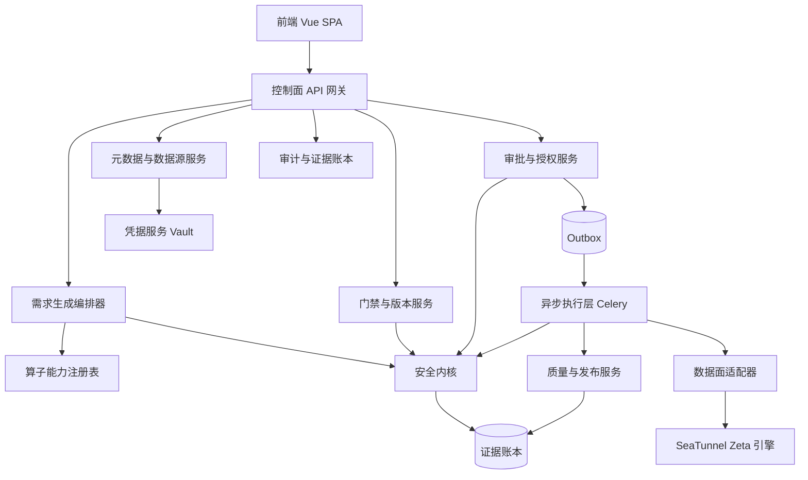
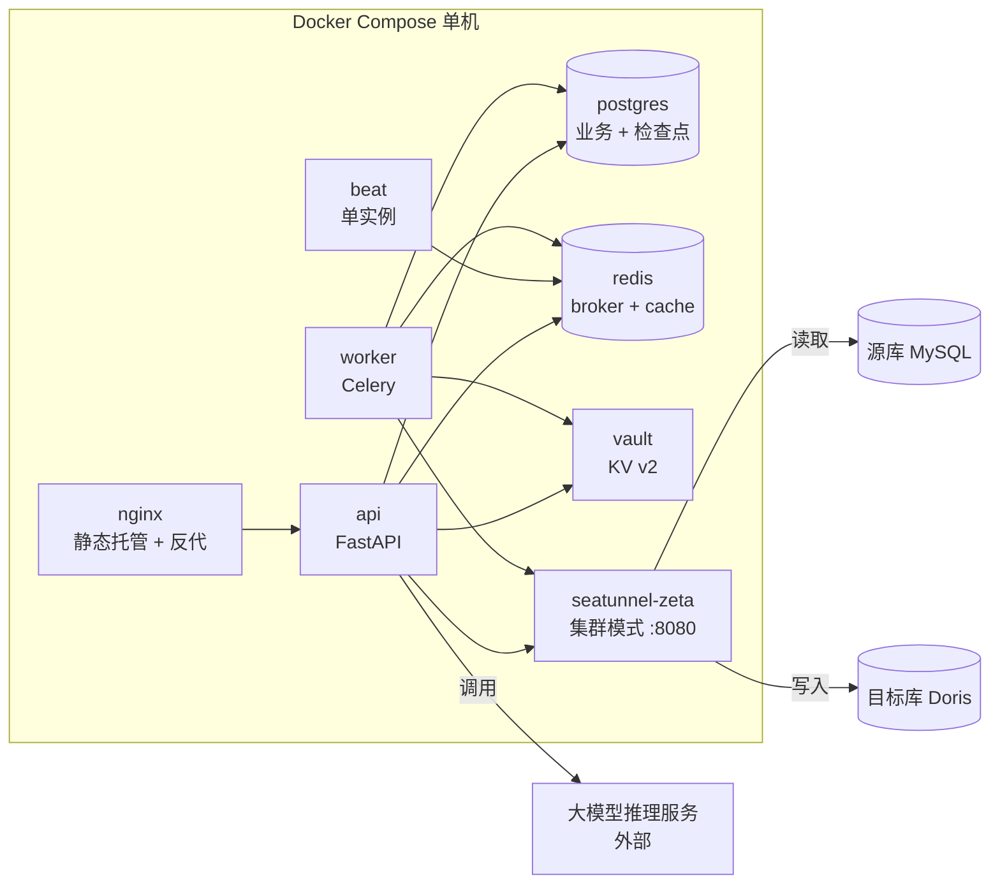
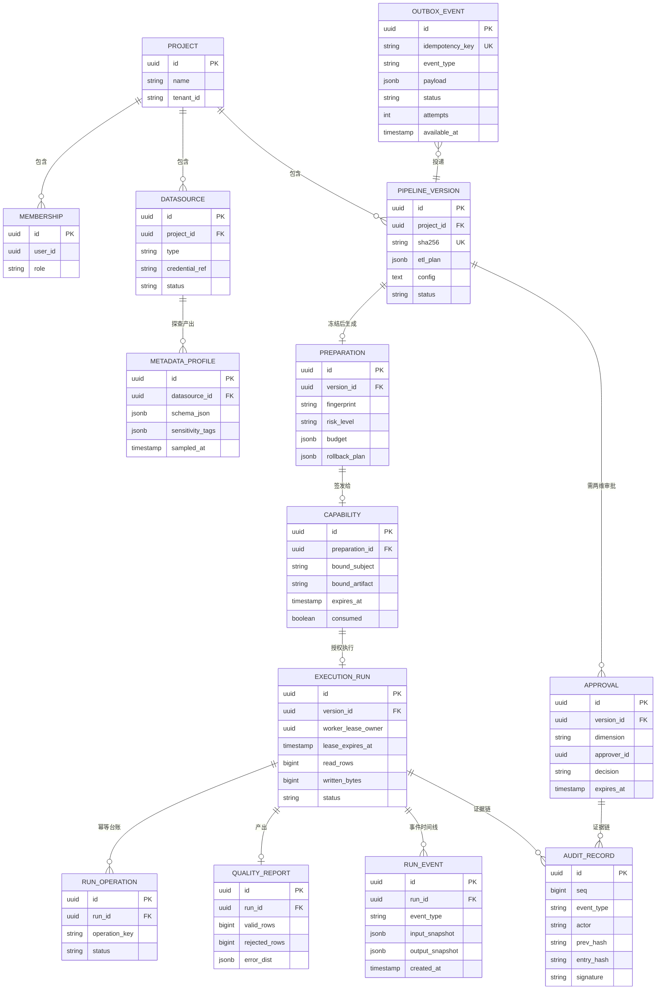
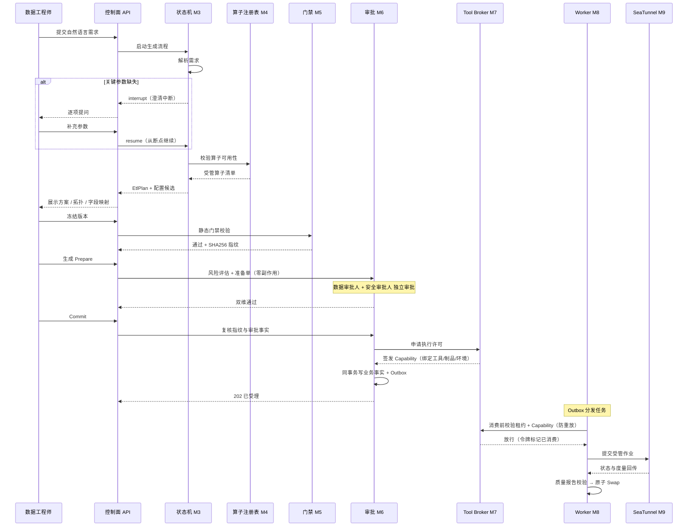
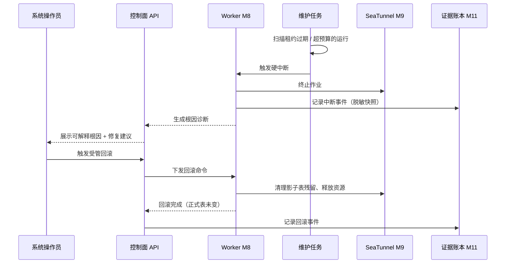

# 生产级 ETL-Agent 数据集成平台 技术设计规格说明书（Design Spec）

> | 文档名称 | 技术设计规格说明书 |
> |----------|-------------------|
> | 版本 | v1.0 |
> | 架构师角色 | 系统架构师 |
> | 日期 | 2026-10-13 |
> | 状态 | 基线 |
> | 依据 PRD | 《生产级 ETL-Agent 数据集成平台需求规格说明书》v1.0（基线） |
> | 交付窗口 | 2026-10-13 ~ 2026-10-27（15 天） |

> **设计目标**：把 PRD 的「要什么」翻译成「怎么做」——确定架构风格、拆解模块、定义接口契约、细化数据模型、给出非功能落地手段，并以 ADR 记录关键选型。本规格与 PRD 的功能编号（FR-xx）逐条可回溯。

---

## 1. 架构设计概述

- **架构风格**：**前后端分离 + 控制面 / 数据面严格分离 + 状态机编排 + 事件驱动投递**。

| 平面 | 组成 | 职责 | 明确不做 |
|------|------|------|---------|
| **控制面** | Vue SPA + FastAPI 服务 + PostgreSQL + Redis | 认证鉴权、数据源登记、元数据探查、方案生成、门禁校验、版本冻结、审批授权、调度决策、审计查询 | **不搬运业务数据**、不直连生产库读明细 |
| **数据面** | Apache SeaTunnel Zeta 引擎 | 执行实际数据搬运、质量分流、影子表写入 | 不做审批决策、不持有凭据明文 |
| **编排内核** | LangGraph 状态机 | 需求解析 → 澄清中断 → 方案生成 的流程编排与断点恢复 | 不执行副作用 |
| **安全内核** | PDP + Tool Broker + Capability + Replay Guard | 所有副作用的唯一出口与准入判定 | 不承载业务逻辑 |

- **选型理由与权衡**：
  1. **为什么控制面与数据面分离**：ETL 的数据搬运量级远超控制面承受能力，若让控制面直连搬运，控制面会成为吞吐瓶颈与单点；分离后控制面只需下发「受管执行命令」并接收度量回传，且**数据作业运行期间控制面可独立重启**（PRD 第 5 章「状态可恢复」依赖此点）。**代价**：需要一套受管命令协议与状态回传机制，复杂度高于单体。
  2. **为什么用状态机而非线性脚本**：需求生成天然是「多轮 + 可中断（澄清）+ 可恢复」的流程（FR-09/FR-10），状态机 + 检查点能精确表达「中断后从断点继续、已完成阶段不重跑」。**代价**：引入框架依赖与检查点存储。
  3. **为什么事件驱动投递**：`Commit` 之后的任务投递若直接调用 Celery，会出现「业务事实已落库但任务投递失败」的撕裂（FR-28）。采用事务性 Outbox 后，投递由搬运者异步完成。**代价**：投递存在秒级延迟，且需维护 Outbox 表与分发任务。

- **对应 PRD**：第 10 章「架构约束」要求「所有副作用执行必须经唯一出口、存在旁路执行路径 = 不可接受」，本设计以 **Tool Broker（§3 M7）** 落实该约束。

## 2. 技术栈与依赖

| 层 | 技术选型 | 用途 | 来源 |
|----|---------|------|------|
| 前端 | Vue 3 + Vite + TypeScript + Pinia + Vue Router | 四个页面工作台 | **PRD 既定** |
| 后端框架 | FastAPI + Pydantic v2 + SQLAlchemy 2.x + Alembic | 控制面 API、数据模型、迁移 | **PRD 既定** |
| 编排 | LangGraph（`StateGraph` + `PostgresSaver` 检查点） | 需求生成状态机、中断恢复 | **PRD 既定** |
| 异步 | Celery（Worker + Beat）+ Redis | 任务执行、定时维护 | **PRD 既定** |
| 存储 | PostgreSQL 16 | 业务事实 + 状态机检查点 + 证据账本 | **PRD 既定** |
| 存储 | Redis 7 | Celery Broker/Backend、短期缓存 | **PRD 既定** |
| 数据面 | Apache SeaTunnel 2.3.13（Zeta 引擎） | 数据搬运、质量分流；**单节点集群模式 + REST API(8080)** | **PRD 既定**（模式由本次调研确定） |
| 大模型 | DeepSeek `deepseek-chat`（OpenAI ChatCompletions 兼容协议） | 需求解析与方案生成 | **PRD 第 10 章外部依赖**；模型名与停用说明见 §11 |
| 凭据 | HashiCorp Vault KV v2（开发环境可降级为本地 SecretProvider） | 凭据加密存储与引用 | **PRD 既定**（降级方案为本次引入） |
| 签名 | Ed25519（`cryptography` 库） | 能力令牌签发与校验 | **PRD 既定**（库选型为推荐） |
| 可观测 | OpenTelemetry（Tracing）+ 结构化 JSON 日志 | 链路追踪、事件时间线 | 本次引入（Phase 8 要求） |
| 部署 | Docker Compose | 单机交付 | **PRD 第 10 章「交付环境约束」** |

- **第三方依赖**：`pydantic`（契约校验）、`sqlalchemy`+`alembic`（ORM/迁移）、`celery`+`redis`（异步）、`langgraph`+`langgraph-checkpoint-postgres`（编排与持久化）、`cryptography`（Ed25519）、`hvac`（Vault 客户端）、`openai`（调用 DeepSeek 兼容接口，用于多 Provider 适配 FR-16）、`pymysql`/`psycopg`（数据库驱动）、`opentelemetry-*`（追踪）。**均为本次引入**，无既定版本锁定。

## 3. 模块 / 服务划分



| 模块 | 职责边界（做什么 / **不做什么**） | 覆盖 FR |
|------|--------------------------------|--------|
| **M1 控制面 API 网关** | 统一路由、认证鉴权、RBAC 校验、请求校验、审计埋点 / **不做业务决策** | FR-44、FR-45 |
| **M2 元数据与数据源服务** | 连接登记与连通性测试、只读元数据探查、脱敏采样、**敏感分级自动打标**、Profile 版本留档 / **不返回明文数据、不透传凭据** | FR-01~FR-07 |
| **M3 需求生成编排器** | 自然语言解析、澄清中断与恢复、调用模型生成 EtlPlan 与配置候选 / **不执行副作用、不跳过门禁** | FR-08~FR-17 |
| **M4 算子能力注册表** | 维护受管算子清单（标识/类型/属性/方言约束），约束生成空间 / **不实现算子执行** | FR-11、FR-14 |
| **M5 门禁与版本服务** | 确定性静态校验（语法 + Schema 对齐）、版本冻结与 SHA256 指纹、版本间 Diff / **不做人工审批判断** | FR-18~FR-20 |
| **M6 审批与授权服务** | 风险评级、Prepare 准备单生成（零副作用）、双维审批、职责分离校验、Commit 收口、Capability 签发 / **不执行数据搬运** | FR-21~FR-28 |
| **M7 安全内核** | PDP 风险决策、Tool Broker（副作用唯一出口）、防重放 Guard、Capability 校验 / **不承载业务语义** | FR-26、FR-27 及全局约束 |
| **M8 异步执行层** | 任务认领、租约续期、执行编排、进度回传、取消与失败处理 / **不做质量判定** | FR-29~FR-31 |
| **M9 数据面适配器** | 经 SeaTunnel REST API 提交作业（`POST /submit-job`）并轮询状态与度量（`GET /job-info/:jobId`、`POST /stop-job`）/ **不解析业务数据内容** | FR-30 |
| **M10 质量与发布服务** | 质量契约执行、错误分流、影子表写入与原子 Swap（Doris `ALTER TABLE t1 REPLACE WITH TABLE t2 PROPERTIES('swap'='true')`，**保留旧表以支持回滚**）、预算监督与硬中断、根因诊断、受管回滚 / **不做审批决策** | FR-32~FR-38 |
| **M11 审计与证据账本** | 哈希链事件落库、审计报告输出、Benchmark 结果留存 / **不做数据修改** | FR-39~FR-43 |
| **M12 前端 Vue SPA** | 四个页面（工作台 / Studio / 运行与审批 / 安全治理）/ **不做任何业务校验**（服务端必须独立校验） | 全部 US |
| **M13 凭据服务** | Vault KV v2 读写、凭据引用签发 / **任何接口不返回明文** | FR-03 |

## 4. 部署拓扑



- **环境差异**：
  - **开发环境（dev）**：单元测试使用内存 SQLite + 模型/投递替身（mock），**不消费真实额度**；不依赖 Vault（用本地 SecretProvider）。
  - **演示环境（demo）**：全栈 Compose，Vault dev 模式，SeaTunnel **单节点集群模式**（`seatunnel-cluster.sh -d`，REST API 8080；`hazelcast.yaml` 的 `member-list` 仅 `localhost`）；演示数据由造数脚本生成（PRD 第 10 章「交付环境约束」）。**不用 Local 模式**——Local 模式不支持作业列表与状态查询，无法满足 FR-30 的状态回传。
  - **不引入 Kubernetes**（PRD 明确）。
- **关键部署约束**（源自附录 D.4 踩坑）：API 与 Worker **必须连同一个 PostgreSQL**；`beat` **单实例**否则重复投递；环境变量变更须 `--force-recreate` 而非 `restart`；不使用 `down -v`（会删除数据卷）。

- **Windows 平台约束（2026-10-13 实测确认）**：本机为 Windows 11 + Docker Desktop（WSL2 后端），以下三点已改变原设计假设——
  1. **容器 IP 对宿主机不可路由**。实测宿主可访问映射端口（`127.0.0.1:8040`）但访问容器 IP（`172.30.80.5`）100% 丢包。Doris 的 Stream Load 要求客户端拿到 FE 返回的 **BE 地址后直连 BE**，因此**数据面组件（SeaTunnel）必须与 Doris 处于同一 Docker 网络**，不能部署在宿主机上（原 §4 拓扑假设二者同机即可）。**这也意味着 M9 数据面适配器应与 SeaTunnel 同容器网络部署。**
  2. **端口映射须避让 Windows 保留段**。实测保留段 `8978-9077` 罩住 Doris 默认的 9030（`bind: forbidden by access permissions`），宿主映射改用 8050；且 winnat 还会动态保留端口，内部通信端口（9010/9050/9060）不应暴露到宿主。
  3. **Doris BE 有内核前置条件**：需 `vm.max_map_count >= 2000000` 且**关闭 swap**，否则 BE 容器 entrypoint 主动 `Exited (0)`。WSL2 各发行版共享内核，在任一发行版设置即全局生效。

## 5. 数据模型（ER）



**关键约束与索引**（细化到可建表）：

| 表 | 关键约束 / 索引 | 设计意图 |
|----|---------------|---------|
| `PIPELINE_VERSION` | `sha256` UNIQUE；冻结后禁止 UPDATE | 版本不可变（FR-19） |
| `APPROVAL` | `(version_id, dimension)` UNIQUE；`expires_at` 非空 | 每版本每维度仅一条有效审批；超时自动失效（PRD 第 5 章「治理」） |
| `CAPABILITY` | `consumed` 默认 false；签发时写 `expires_at = now + 5min` | 单次消费（FR-27） |
| `EXECUTION_RUN` | `worker_lease_owner` + `lease_expires_at` | 租约 fencing，防旧 Worker 写回终态 |
| `RUN_OPERATION` | `(run_id, operation_key)` UNIQUE | 幂等台账，副作用仅执行一次（FR-27） |
| `AUDIT_RECORD` | `seq` UNIQUE 递增；`prev_hash` 指向上一条 `entry_hash` | 哈希链防篡改（FR-39） |
| `OUTBOX_EVENT` | `idempotency_key` UNIQUE；`status/attempts/available_at` 索引 | 原子投递 + 指数退避（FR-28） |
| 全部业务表 | 外键带 `project_id`，跨租户查询在 SQL 层强制过滤 | 多租户隔离（FR-44） |

> **与 PRD 第 8 章的一致性**：PRD 的 11 个实体全部保留；本规格**新增 3 张**（`RUN_OPERATION` 幂等台账、`RUN_EVENT` 事件时间线、`OUTBOX_EVENT` 投递表），来源为附录 D.1「实体分层」（Task ≠ Run ≠ RunEvent ≠ Operation）。`AUDIT_RECORD` 在 PRD 基础上补充 `seq / entry_hash` 以支持哈希链。

## 6. 关键接口定义

| 编号 | 方法 | 路径 | 说明 | 对应 FR |
|------|------|------|------|--------|
| API-01 | POST | `/api/v1/datasources` | 登记数据源连接（凭据只传引用） | FR-01、FR-03 |
| API-02 | POST | `/api/v1/datasources/{id}/profile` | 发起只读元数据探查（含分级打标） | FR-05、FR-06 |
| API-03 | POST | `/api/v1/pipelines/generate` | 提交自然语言需求，可能返回「澄清中断」 | FR-08、FR-09 |
| API-04 | POST | `/api/v1/pipelines/{run_id}/resume` | 补充澄清信息后从断点继续 | FR-10 |
| API-05 | POST | `/api/v1/versions/{id}/freeze` | 门禁通过后冻结不可变版本 | FR-18、FR-19 |
| API-06 | POST | `/api/v1/preparations` | 生成 Prepare 准备单（**零外部副作用**） | FR-22 |
| API-07 | POST | `/api/v1/approvals/{id}/decide` | 提交审批决定（approve / reject） | FR-23、FR-24 |
| API-08 | POST | `/api/v1/commits` | Commit：复核审批事实 → 签发 Capability → 写 Outbox | FR-25、FR-26 |
| API-09 | GET | `/api/v1/runs/{id}` | 查询运行状态与度量 | FR-29、FR-30 |
| API-10 | POST | `/api/v1/runs/{id}/rollback` | 受管回滚 | FR-38 |

**OpenAPI 片段示例（API-08 Commit）**：

```yaml
post:
  summary: 执行 Commit，签发单次能力令牌并投递执行任务
  security: [{ bearerAuth: [] }]
  requestBody:
    required: true
    content:
      application/json:
        schema:
          type: object
          required: [preparation_id, expected_fingerprint]
          properties:
            preparation_id: { type: string, format: uuid }
            expected_fingerprint: { type: string, description: 客户端持有的准备单指纹，服务端复核 }
  responses:
    '202':
      description: 已受理，任务经 Outbox 投递
      content:
        application/json:
          schema:
            type: object
            properties:
              run_id: { type: string }
              capability_expires_at: { type: string, format: date-time }
    '403': { description: 审批未完成或职责分离违规, 错误码: POL_APPROVAL_INCOMPLETE }
    '409': { description: 指纹不匹配或令牌已消费, 错误码: BIZ_FINGERPRINT_MISMATCH }
    '503': { description: 数据面不可达, 错误码: SYS_DATAPLANE_UNAVAILABLE }
```

**平台基础与支撑接口**（T-01 ~ T-05 实现，不在上表 10 条业务契约内）：

| 编号 | 方法 | 路径 | 说明 | 对应 FR |
|------|------|------|------|--------|
| API-P1 | POST | `/api/v1/auth/register` | 注册用户 | FR-44 |
| API-P2 | POST | `/api/v1/auth/login` | 登录，签发会话令牌 | FR-44 |
| API-P3 | GET | `/api/v1/auth/me` | 当前用户 | FR-44 |
| API-P4 | POST | `/api/v1/projects` | 创建项目（创建者自动为 MAKER） | FR-44、FR-45 |
| API-P5 | GET | `/api/v1/projects` | 列出我参与的项目 | FR-44 |
| API-P6 | GET | `/api/v1/projects/{project_id}` | 项目详情（须为项目成员） | FR-44 |
| API-P7 | GET / POST | `/api/v1/projects/{project_id}/members` | 成员列表 / 邀请成员（限 MAKER） | FR-45 |
| API-P8 | PATCH / DELETE | `/api/v1/projects/{project_id}/members/{membership_id}` | 改角色 / 移除成员（限 MAKER） | FR-45 |
| API-P9 | GET | `/api/v1/datasources?project_id=` | 数据源列表 | FR-01 |
| API-P10 | POST | `/api/v1/datasources/{id}/test` | 安全连通性测试（只执行 `SELECT 1`） | FR-04 |
| API-P11 | GET | `/api/v1/datasources/{id}/profiles` | 探查结果历史留档 | FR-07 |
| API-P12 | GET | `/api/v1/operators`、`/operators/summary`、`/operators/{id}` | 受管算子清单（M4 注册表） | FR-11、FR-14 |

> **编号约定**：用 `API-P*` 前缀与上表的 10 条契约冻结条目区隔，避免 T-22 前端的契约基线发生漂移。
> **令牌区分**：本表用的是**登录会话令牌**（HS256 JWT，默认 60 分钟），仅用于接口鉴权；
> 执行授权用的**单次能力令牌 Capability**（Ed25519、绑定工具/主体/环境/制品、5 分钟有效、仅可消费一次）
> 是独立机制，见 FR-26 / FR-27 与 T-10。

**错误码体系（段位划分）**：

| 段位 | 含义 | 示例 |
|------|------|------|
| `AUTH_` | 认证与租户 | `AUTH_TOKEN_EXPIRED`、`AUTH_CROSS_TENANT` |
| `POL_` | 策略与审批 | `POL_APPROVAL_INCOMPLETE`、`POL_SELF_APPROVAL_DENIED`、`POL_RISK_BLOCKED` |
| `BIZ_` | 业务规则 | `BIZ_FINGERPRINT_MISMATCH`、`BIZ_OPERATOR_NOT_SUPPORTED`、`BIZ_BUDGET_EXCEEDED` |
| `SYS_` | 系统与依赖 | `SYS_DATAPLANE_UNAVAILABLE`、`SYS_MODEL_TIMEOUT`、`SYS_LEASE_LOST` |

**统一错误响应体**——所有错误出口（含框架自身抛出的 404 / 405 / 422）都必须是这个结构：

```json
{"code": "AUTH_TOKEN_INVALID", "message": "令牌无效或已过期", "detail": null}
```

前端**只按 `code` 分支处理，不得依赖 `message` 文案**。已发布的编码不得复用或改义。
实现见 `api/app/core/errors.py`。

## 7. 关键流程时序图

### 7.1 需求生成与受管发布（主链路）



### 7.2 任务中断诊断与受管回滚



## 8. 非功能设计

| 维度 | PRD 指标 | 设计手段 |
|------|---------|---------|
| **安全** | 凭据全加密、接口与日志无明文 | Vault KV v2 存值、业务库仅存 `credential_ref`；`redact_snapshot` 统一脱敏（正则命中密钥类键即替换，深度 8 / 条数 200 / 长度 2000 上限），**证据落库前必过** |
| **安全** | 授权令牌 ≤5 分钟且单次 | Ed25519 签发，载荷绑定「工具 + 主体 + 制品 + 环境」，`consumed` 标记 + 校验时置位 |
| **安全** | P0/P1 高危拦截 100%、自批拦截 100% | PDP 返回确定性决策（策略许可 ≠ 可跳过审批）；`(version_id, dimension)` 唯一约束 + 提交时硬校验 `approver_id ≠ 提交人` |
| **安全** | 证据不可篡改、篡改可检出 | `seq` 递增 + `prev_hash` 链 + 签名检查点；提供校验器，启动时与定期巡检 |
| **性能** | 控制面常规接口 P95 < 500ms | 高频查询建索引（`project_id`、`status`）；连接池；元数据走缓存 |
| **性能** | 生成端到端（不含澄清等待）P95 < 60s | 生成走异步任务 + 前端轮询/流式；注册表约束缩短模型输出空间；模型上下文充裕（128K 级），算子注册表与 Schema 摘要可整体注入，无需分片 |
| **性能** | 元数据探查（500 表 / 1 万字段）< 30s | 并发采样 + 连接复用；近似统计而非全表扫描；结果落 `METADATA_PROFILE` 复用 |
| **高可用** | 控制面重启后断点恢复 | 状态机检查点落 PostgreSQL；API 无状态可多副本；重启后从线程标识恢复 |
| **高可用** | 任务重复投递仅执行一次 | `(run_id, operation_key)` 唯一约束 + 副作用前先查台账；已完成的直接返回历史结果 |
| **高可用** | Worker 心跳失败不伪造成功 | 租约 fencing：`lease_owner` 条件 UPDATE 判 `rowcount==1`，失败即自退出；租约过期由维护任务回收重排 |
| **可观测** | 全链路可追踪 | OpenTelemetry Tracing（`trace_id`/`span_id` 落 `RUN_EVENT`）；结构化 JSON 日志；运行度量（吞吐/行数/拒绝率）经 `RUN_EVENT.metrics` 回传 |

## 9. 设计决策记录（ADR）

| 编号 | 决策 | 背景 / 选项 | 选择理由 | 后果 |
|------|------|------------|---------|------|
| **ADR-01** | 控制面与数据面严格分离 | A. 控制面直连搬运；B. 分离，控制面只下发受管命令 | 海量搬运会使控制面成为瓶颈与单点；分离后控制面可独立重启而数据作业不受影响（PRD 要求「状态可恢复」） | 需自研受管命令协议与状态回传；运维组件增多 |
| **ADR-02** | 用 LangGraph 承担需求生成编排 | A. 手写状态流转；B. LangGraph 状态机 + 检查点 | 需求生成是多轮可中断流程，检查点天然支持「断点续跑、已完成阶段不重跑」（FR-10） | 引入框架依赖；检查点存储需纳入备份 |
| **ADR-03** | 能力令牌用 Ed25519 签名而非会话鉴权 | A. 复用会话 Token；B. 独立签发单次 Capability | 会话 Token 无法表达「绑定本次执行、仅可用一次、5 分钟失效」；签名使数据面可独立验签而不回查控制面 | 需管理签名密钥对与轮转 |
| **ADR-04** | 任务投递用事务性 Outbox | A. 业务提交后直接投递；B. 同事务写 Outbox 后异步搬运 | 直接投递存在「落库成功但任务丢失」的撕裂（FR-28）；Outbox 保证投递与事实同事务 | 投递存在秒级延迟；需维护 Outbox 表与分发任务 |
| **ADR-05** | 生成空间由算子注册表约束 | A. 让模型自由生成；B. 受管清单内闭合生成 | 自由生成会编造不存在的组件（幻觉）；清单约束可在无法匹配时明确返回「不支持」（FR-14） | 需维护注册表并随算子演进更新 |
| **ADR-06** | 发布用影子表 + 原子 Swap | A. 直接写入目标表；B. 写影子表，校验通过后替换 | 直接写入在失败时污染正式表且无法回滚；影子表使失败可安全丢弃（FR-34、FR-38）。Doris 有原生 `REPLACE WITH TABLE ... ('swap'='true')`，元数据层原子事务 | 需目标库支持该语法；`swap=true` 会占用双份存储；Doris 不校验两表 schema，须自行保证 |
| **ADR-07** | SeaTunnel 采用**集群模式**而非 Local 模式 | A. Local 模式（提交进程内嵌引擎，作业结束即退出）；B. 单节点集群模式 | Local 模式**不支持作业列表、状态查询、暂停/恢复**，无法满足 FR-30「状态回传」；集群模式提供 `/submit-job`、`/job-info/:jobId`、`/stop-job` 完整 REST API | 需常驻一个引擎进程与额外内存；单节点无高可用，但课程场景足够 |

## 10. 任务分解清单

> 按 PRD 第 10 章「交付节奏」三段组织；依赖列中「—」表示无前置。

| 任务编号 | 模块 | 依赖 | 说明 | 阶段 |
|---------|------|------|------|------|
| T-01 | M1 + 基础设施 | — | Compose 骨架、PostgreSQL/Redis/Vault 起服务、Alembic 初始化、认证与多租户隔离 | D1–D5 |
| T-02 | M13 | T-01 | 凭据服务（Vault KV v2 适配 + 本地降级） | D1–D5 |
| T-03 | M2 | T-01、T-02 | 数据源登记、连通性测试、只读元数据探查 | D1–D5 |
| T-04 | M2 | T-03 | 脱敏采样 + 敏感分级自动打标（附录 C 规则） | D1–D5 |
| T-05 | M4 | — | 算子能力注册表（P0 约 10 个算子）与属性清单 | D1–D5 |
| T-06 | M3 | T-01、T-05 | 状态机骨架、需求解析、EtlPlan 与配置候选生成 | D1–D5 |
| T-07 | M3 | T-06 | 澄清中断与断点恢复 | D1–D5 |
| T-08 | M5 | T-06 | 确定性静态门禁（语法 + Schema 对齐） | D1–D5 |
| T-09 | M5 | T-08 | 版本冻结与 SHA256 指纹、版本 Diff | D1–D5 |
| T-10 | M7 | T-01 | 安全内核：PDP 决策、Tool Broker、Capability 签发/校验、Replay Guard | D6–D10 |
| T-11 | M6 | T-09、T-10 | 风险评级、Prepare 准备单（零副作用）、双维审批、职责分离校验 | D6–D10 |
| T-12 | M6 | T-11 | Commit 收口 + 指纹/审批复核 + Capability 签发 | D6–D10 |
| T-13 | M8 + 投递 | T-10、T-12 | 事务性 Outbox + 分发任务 + Celery 任务认领 | D6–D10 |
| T-14 | M8 | T-13 | 租约 fencing、心跳续期、协作式取消、失败处理 | D6–D10 |
| T-15 | M9 | T-13 | 数据面适配器：经 REST `POST /submit-job` 提交、`GET /job-info/:jobId` 轮询状态、`POST /stop-job` 终止 | D6–D10 |
| T-16 | M10 | T-15 | 质量契约执行、错误分流、影子表写入与原子 Swap | D6–D10 |
| T-17 | M10 | T-16 | 运行时预算监督、超预算硬中断、根因诊断 | D6–D10 |
| T-18 | M10 | T-17 | 受管回滚 | D6–D10 |
| T-19 | M8 + 维护 | T-14 | 维护任务：超时回收、审批过期级联终止、租约回收重排 | D11–D15 |
| T-20 | M11 | T-10 | 证据账本：哈希链落库 + 校验器 + 审计报告输出 | D11–D15 |
| T-21 | M11 | T-06 | Benchmark 评测集与准确率大盘 | D11–D15 |
| T-22 | M12 | T-11、T-21 | 前端四页面（工作台 / Studio / 运行与审批 / 安全治理） | D11–D15 |
| T-23 | 全链路 | T-18、T-22 | 端到端联调与演示准备 | D11–D15 |

- **可并行**：T-05 与 T-01~T-04 并行；T-20/T-21 与 T-19 并行；T-22 前端可与后端联调并行启动。
- **强串行**：T-10（安全内核）是 T-11~T-13 的前置，须优先完成。

### 10.1 实施进度（截至 2026-10-14）

| 任务 | 状态 | 落地位置 |
|------|------|---------|
| T-01 工程骨架 | ✅ 完成 | `api/app/core/`、`api/app/models/identity.py`、`api/app/api/routes/{auth,projects}.py`、`api/alembic/` |
| T-02 凭据服务 | ✅ 完成 | `api/app/services/credentials.py`（Vault KV v2 + 本地 Fernet 降级） |
| T-03 数据源接入 | ✅ 完成 | `api/app/models/datasource.py`、`api/app/services/datasource.py`、`api/app/api/routes/datasources.py` |
| T-04 敏感分级 | ✅ 完成 | `api/app/services/sensitivity.py`（附录 C 规则表） |
| T-05 算子注册表 | ✅ 完成 | `api/app/registry/`（13 个 P0 算子） |
| T-06 需求生成 | ✅ 完成 | `api/app/services/orchestrator.py`、`prompts.py`、`config_renderer.py`、`api/app/api/routes/pipelines.py` |
| T-07 澄清中断与恢复 | ✅ 完成 | 同上（`ask_clarification` 节点 + `POST /pipelines/{run_id}/resume`） |
| T-08 静态门禁 | ✅ 完成 | `api/app/services/gate.py`（语法 / 算子在册 / Schema 对齐） |
| T-09 版本冻结与 Diff | ✅ 完成 | `api/app/services/versioning.py`、`api/app/api/routes/versions.py` |
| T-10 安全内核 | ✅ 完成 | `api/app/core/keys.py`、`api/app/services/{capability,tool_broker,pdp}.py` |
| T-11 准备单与双维审批 | ✅ 完成 | `api/app/models/approval.py`、`api/app/services/approval.py`、`api/app/api/routes/approvals.py` |
| T-12 Commit 收口 | ✅ 完成 | `api/app/services/commit.py`、`api/app/api/routes/commits.py`、`api/app/models/execution.py`（`execution_runs` / `outbox_events`） |
| T-13 Outbox 分发与任务认领 | ✅ 完成 | `api/app/services/outbox.py`、`api/app/services/execution.py`、`api/app/worker/`（Celery）、`api/app/api/routes/runs.py` |
| T-14 租约 fencing 与取消 | ✅ 完成 | `api/app/services/lease.py`、`api/app/services/execution.py`、`run_operations` 幂等台账 |
| T-15 ~ T-23 | ⬜ 未开工 | — |

**T-01 的实际落地范围**比任务表描述多两项——统一错误码体系（§6 段位划分）与项目/成员管理（FR-45）。
二者是后续所有接口的公共地基，放在骨架阶段一次做掉，避免接口变多后再回头改错误契约。

**T-07 与 T-06 合并实现**：LangGraph 的中断与恢复是同一套机制，拆成两个任务会产生
「状态机骨架」和「断点恢复」两份互相耦合的代码。实际落地为 `states → interrupt → resume` 一条链路。

**测试基线**：315 个用例全部通过，覆盖 T-01 ~ T-14。开发环境按 §4 约定使用
**内存 SQLite + 替身数据源 + 替身模型 + 替身数据面**，不依赖 PostgreSQL / Redis / Vault，
也不消费大模型额度；Celery 应用可导入、Beat 调度表可断言，但不连 broker。

**端到端已验证**：真实 PostgreSQL + LangGraph 断点持久化环境下，
「生成 → 落草稿版本 → 门禁 → 冻结 → Prepare → 双维审批 → Commit（签发令牌 + 写 Outbox）」
链路跑通，冻结产物的 SHA256 指纹可复算；迁移经 `alembic upgrade head` / `downgrade` 往返
与 `alembic check`（模型与库零差异）验证。

**M8 的边界（T-15 之前）**：`app/services/execution.py` 只认 `DataPlane` 协议，
默认实现是 `UnavailableDataPlane`——数据面未接通时运行**明确失败**并落
`SYS_DATAPLANE_UNAVAILABLE`，而不是空跑成功。T-15 接上 SeaTunnel 适配器后，
认领、事件、终态写入、幂等台账都不必改动。

**仍未闭环**：

1. §11.1 的 V3（DeepSeek API 可用性）尚未实测。当前开发与测试全部走 `LLM_BACKEND=fake`，
   真实模型联调前必须先完成 V3 验证。
2. **数据面未接通**（T-15）：受管执行目前必然以 `SYS_DATAPLANE_UNAVAILABLE` 收敛。
3. **租约回收未实现**（T-19）：租约过期的运行不会被自动回收重排，须由维护任务补上；
   fencing 已就位，回收后旧 Worker 的写回会被拒绝。

## 11. 待明确事项

**本规格原 7 项待明确事项已全部闭环**（Q1、Q4 经本地制品与官方文档查证，Q2、Q6 由项目组拍板，Q3、Q5、Q7 由架构评审定案）。决策痕迹如下：

| 编号 | 原问题 | 结论 | 依据 |
|------|--------|------|------|
| Q1 | SeaTunnel 部署模式 | **单节点集群模式**（`seatunnel-cluster.sh -d`），REST API 端口 8080 | Local 模式不支持作业列表/状态查询/暂停恢复，无法满足 FR-30；集群模式提供完整 REST 端点。本地 2.3.13 发行包已默认开启 `enable-http: true, port: 8080` |
| Q2 | 大模型 Provider | **DeepSeek `deepseek-chat`**（OpenAI 兼容协议） | 项目组指定。**注**：官方 `deepseek-chat` 别名已于 2026-07-24 停用并自动路由至 `deepseek-v4-flash`；直连官方 API 时实际调用为 v4-flash，经第三方平台（如阿里云百炼）可能仍保留该别名。实施见 V3 |
| Q3 | 签名密钥存储与轮转 | 私钥存 **Vault KV v2**，启动加载到内存；公钥分发至数据面独立验签；预留 `kid` 字段，15 天内单密钥不轮转 | 与凭据统一治理，避免密钥文件散落 |
| Q4 | Doris 影子表原子 Swap | **支持**：`ALTER TABLE t1 REPLACE WITH TABLE t2 PROPERTIES('swap'='true')`，元数据层原子事务、查询无中间态 | Doris 0.14+ 原生能力。**必须 `swap=true`**——`swap=false` 会直接删除旧表，导致 FR-38 无法回滚。注意 Doris 不校验两表 schema 一致性，须由本项目自行保证 |
| Q5 | 证据账本签名检查点频率 | **哈希链逐条 + 签名按批**（每 100 条或每 5 分钟锚定链头，可配） | 链完整性靠哈希、防篡改靠锚定；避免每条都做密钥操作 |
| Q6 | 15 天窗口是否裁剪 | **不裁剪**，T-01~T-23 全做 | 项目组决定 |
| Q7 | 前端是否并行开发 | **并行**：先冻结 §6 的 10 个 API 契约，前端以 mock server 先行 | 契约冻结是并行前提 |

### 11.1 实施中仍需验证的事项

| 编号 | 事项 | 状态 |
|------|------|------|
| V1 | Doris 目标库版本与 `REPLACE WITH TABLE` 可用性 | ✅ **已验证**（见下） |
| V2 | SeaTunnel Doris Sink 参数 | ✅ **已验证**（见下） |
| V3 | DeepSeek API 可用性（模型名、配额、网络可达） | ⏳ **待验证**——M3 已用 `LLM_BACKEND=fake` 完成开发与测试，接入真实模型前必须实测 |

**V1 结论**：目标库采用 **Apache Doris ≥ 2.0（建议 2.1.x LTS）**。

- `ALTER TABLE ... REPLACE WITH TABLE ... ('swap'='true')` 需 Doris ≥ 0.14，且**两张表必须都是 OLAP 内部表**——视图或外部表不可用；
- SeaTunnel Doris Sink 的 Exactly-Once / CDC 需 Doris ≥ 1.1.x；
- Doris Source 需 ≥ 2.0。

三者取交集 → **≥ 2.0**。影子表方案（FR-34）因此成立，但**两表结构一致性须由本项目自行保证**（Doris 不校验）。

**V2 结论**：Doris Sink 参数如下——

| 参数 | 必填 | 说明 |
|------|------|------|
| `fenodes` | 是 | FE 地址，格式 `ip:8030` |
| `username` / `password` | 是 | 由 Vault 注入，配置文件不落明文 |
| `database` + `table` | 是 | **`table.identifier` 自 SeaTunnel 2.3.5 起已废弃**，须用新写法 |
| `sink.label-prefix` | 是 | Stream Load 标签前缀，**必须按作业全局唯一**（2PC 重启复用会报 `Label already exists`） |
| `sink.enable-2pc` | 否 | 开启 Exactly-Once |
| `sink.enable-delete` | 否 | 启用删除事件同步 |

> **设计呼应**：`sink.label-prefix` 的「按作业全局唯一」要求，与 FR-27 的幂等语义天然吻合——实现时直接用 `run_id` 作前缀即可，无需额外设计。

### 11.2 V2 衍生的开工前置项（✅ **已解除**，2026-10-14）

本地 `seatunnel/apache-seatunnel-2.3.13/connectors/` 原仅有 3 个 jar，**现已补装完成**，实际清单：

| jar | 用途 |
|-----|------|
| `connector-doris-2.3.13.jar` | Doris Sink（影子表写入） |
| `connector-jdbc-2.3.13.jar` | MySQL / PostgreSQL 等 JDBC 源读取 |
| `connector-cdc-base-2.3.13.jar` | CDC 公共基座 |
| `connector-console-2.3.13.jar` | 控制台调试 |
| `connector-fake-2.3.13.jar` | 造数 |

`config/plugin_config` 已同步追加 `connector-doris` 与 `connector-jdbc`。**T-15 / T-16 的开工前置项已解除。**

> **实施说明**：本项目 P0 场景（全量搬运 → 影子表 → 原子 Swap）使用 **JDBC 源**即可满足，故未安装 `connector-cdc-mysql`；若后续需要增量 CDC 同步再行补装。环境准备与验证步骤见 `deploy/README.md` 第二节。

---

> **本规格与 PRD 的可追溯性**：PRD 的 46 条 FR 全部映射至 §3 模块表的「覆盖 FR」列；PRD 第 8 章 11 个实体在 §5 全部保留并细化；PRD 第 5 章 14 项非功能指标在 §8 逐项给出设计手段。参考实现对标结论见 PRD 附录 D。
